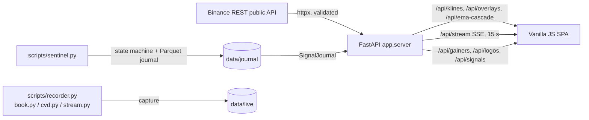

# SIGNAL-X

Observation-only market dashboard: a FastAPI backend over public Binance data,
a no-build vanilla-JS charting SPA, and a set of research/recording scripts.

> **Not financial advice, not a trading system.** The G0 full-universe rerun
> killed the short-edge hypothesis on 2026-10-17 (see
> [`reports/g0_full/VERDICT.md`](reports/g0_full/VERDICT.md)). Everything the
> dashboard shows — EMA cascades, divergences, resistance zones, plateau boxes,
> the sentinel journal — is an *observation*, not a validated trade signal.
> There are no order-entry endpoints.

---

## How it works



- **`app/server.py`** — async FastAPI. Stateless reads over `signalx.feeds`
  (whitelisted Binance endpoints, strict symbol/interval validation), plus an
  SSE loop for live snapshots. The SPA is plain static files: no build step, no
  CDN.
- **`app/static/`** — `chart.js` renders candles/line with EMA overlays,
  pivots, structure/BOS, resistance zones, AVWAP, plateau box, divergence
  labels and a zone-colored RSI pane on canvas. `app.js` wires data polling,
  the observation panel, gainers, notifications and sounds. `logo.js` is the
  animated header.
- **`signalx/`** — the analysis package: feeds/validation, live snapshot,
  EMA cascade, overlays, flow/order-book proxies, journal, universe screening,
  studies, alerts.
- **`scripts/`** — long-running workers and research runners (see
  [Workers & scripts](#workers--scripts)).
- **`tests/`** — 741 pytest tests covering validation, feeds, overlays,
  studies, flow features, the API and the alert redaction layer.

Data is fetched live from public Binance endpoints; nothing is written by the
web app. The journal and capture data belong to the scripts.

---

## Requirements

- Linux (developed on Kali; WSL works) with Python **3.11+** (tested on 3.14)
- A browser with ES2020 + canvas (any current Chrome/Firefox/Safari)
- Network access to `api.binance.com`, `fapi.binance.com` and (optional,
  cosmetic coin icons) `api.coingecko.com`

## Installation

### As a command (native tool install)

```bash
git clone https://github.com/Charpoh-Dehm99/signal-x.git
cd signal-x
pipx install .        # or: python3 -m pip install .
signal-x              # dashboard on http://127.0.0.1:8000
signal-x --port 9000  # any port
```

`signal-x` also takes `--host` and `--reload` (dev). On Termux, install
`pkg install python git python-pyarrow` first (pyarrow has no Android wheel;
the Termux package supplies it), then `pip install .`. If pip tries to compile
`pydantic-core`, add `pkg install rust clang`.

### From a checkout (development)

```bash
git clone https://github.com/Charpoh-Dehm99/signal-x.git
cd signal-x

python3 -m venv .venv
.venv/bin/pip install -U pip
.venv/bin/pip install -r requirements.txt
```

Development extras:

```bash
.venv/bin/pip install pytest anyio
# optional: full research-script deps (pandas/numpy/websockets/requests)
.venv/bin/pip install -e ".[research]"
# linters used during development (isolated):
pipx run bandit -q -r signalx scripts app
```

## Quick start

```bash
signal-x
# or from the checkout:
.venv/bin/python -m uvicorn app.server:app --host 127.0.0.1 --port 8000
```

Open <http://127.0.0.1:8000>. Interactive API docs (OpenAPI) live at
`/api/docs`.

Useful environment variables:

| Variable | Default | Purpose |
|---|---|---|
| `SIGNALX_JOURNAL_DIR` | `data/journal` | where the API reads the sentinel journal |
| `SIGNALX_HEARTBEAT` | `data/sentinel_heartbeat.json` | sentinel sweep heartbeat the dashboard reads for freshness |

> Bind to `127.0.0.1` only. The app has **no authentication** by design — it is
> a single-user localhost tool. If you expose it beyond your machine, put it
> behind a reverse proxy with TLS and auth.

---

## Dashboard usage

| Area | What it does |
|---|---|
| Search / `WATCH` | Load any Binance spot or USDT-M futures symbol (auto-detected) |
| Futures gainers | Top 24h movers; click to load. Gold accent = top 1% of liquid perps |
| Timeframes | `1m · 5m · 15m · 1h · 4h` |
| Overlay chips | EMA 8·13·21, swing pivots, structure, BOS/CHoCH, resistance zones, AVWAP, plateau box, divergence, RSI pane — persisted in `localStorage` |
| Observation panel | Live state badge, events, vol-z/funding/plateau donuts, layers readout (right rail) |
| Fat money | CVD, taker-buy ratio, large prints, book imbalance and absorption proxies (observation only) |
| Signals table | Sentinel journal rows, newest first; header shows sentinel heartbeat age (data freshness, never fetch time) and an explicit offline state |
| Bell | Notification history (persisted, filterable by kind, free-text search, unread tab badge) |
| Sound | WebAudio chimes for EMA crosses/cascades, top-1% entries, journal signals, hot/warn events; volume slider |
| Chart controls | Candle/line mode, full-width chart, reset/live pill |

Chart gestures: wheel = zoom at cursor, drag = pan, double-click (or
double-tap) = focus zoom, Escape = reset. On touch: one finger = crosshair,
two fingers = pan/pinch.

Keyboard shortcuts:

| Key | Action |
|---|---|
| `n` | Notifications panel |
| `b` | Full-width chart |
| `1`–`5` | Timeframe 1m/5m/15m/1h/4h |
| `/` | Focus symbol search |
| `Esc` | Close panel / blur input / reset chart view |

RSI line colors: red in overbought (≥ 70), green in oversold (≤ 30), yellow
between. Divergence labels: `div ↑ long` (bullish) and `div ↓ short` (bearish)
mark the bias of the observation — not an entry.

---

## Workers & scripts

All scripts are observation/capture tools and share the same feed layer.

```bash
# State-machine journal: transitions + short-signal observations for top gainers
.venv/bin/python scripts/sentinel.py --top 40 --tf 5m --interval 60
.venv/bin/python scripts/sentinel.py --top 40 --flow --flow-top 10 --once
.venv/bin/python scripts/sentinel.py --symbols AGTUSDT,AUSDT --once

# Optional Telegram push on TRIGGERED (requires both env vars; text is redacted)
TELEGRAM_BOT_TOKEN=... TELEGRAM_CHAT_ID=... \
  .venv/bin/python scripts/sentinel.py --alert
```

| Script | Purpose |
|---|---|
| `sentinel.py` | Polls the watchlist (one state-machine step per closed bar), writes day-partitioned Parquet journal rows (`data/journal`) plus a per-sweep heartbeat (`data/sentinel_heartbeat.json`), optional Telegram alerts |
| `watch_symbol.py` | Single-symbol live watcher (pump/plateau/resistance/squeeze), `--once` for a snapshot |
| `recorder.py` | Records kline cycles for the watchlist into `data/live/klines` |
| `book.py` | Records bookTicker + depth features (spread/imbalance) |
| `cvd.py` | Records per-minute taker buy/sell notional (CVD) |
| `stream.py` | Live websocket tape of large prints |
| `watchdog.py` | Supervises the observation daemons (restarts dead workers) |
| `download_data.py` | Bulk historical klines/funding download into `data/raw` + `data/parquet` |
| `fetch_universe.py` | Refreshes `data/universe.json` (liquid universe) |
| `screen_universe.py` | Full-universe screening funnel driver |
| `run_event_study.py`, `run_funnel_study.py`, `run_h1_study.py` | Research runners (read the local corpus, write `reports/`) |
| `cost_probe.py` | Cost/impact probe from recorded book features |

Generated data lives under `data/` (gitignored — the local corpus is tens of
gigabytes) and logs under `logs/` (gitignored). Research verdicts live in
`reports/` (committed).

---

## API

Read-only, JSON, same-origin (no CORS).

| Endpoint | Description |
|---|---|
| `GET /` | Dashboard SPA |
| `GET /api/health` | Liveness + "observation only" note |
| `GET /api/gainers?top=&min_quote_volume=` | USDT-M futures 24h gainers + universe size |
| `GET /api/klines/{symbol}?market=&tf=&limit=` | OHLCV candles (incl. the in-progress bar) |
| `GET /api/overlays/{symbol}?market=&tf=&limit=` | Pivots, structure, BOS, zones, AVWAP, plateau box, divergence, RSI (closed bars only) |
| `GET /api/ema-cascade/{symbol}?market=&limit=` | EMA 8/13/21 state per 5m/15m/1h/4h + cross propagation |
| `GET /api/snapshot/{symbol}?market=&tf=` | One observation snapshot |
| `GET /api/stream/{symbol}?market=&tf=&interval=&polls=` | SSE push loop (interval ≥ 1 s) |
| `GET /api/signals?limit=&signals_only=` | Sentinel journal rows + latest state per symbol + `now_ms`/`latest_ts_ms` + sentinel heartbeat status |
| `GET /api/logos?symbols=BTC,ETH,...` | Cosmetic CoinGecko icon map (cached, always 200) |

Symbols must match `^[A-Z0-9]{4,20}$` and intervals are whitelisted; invalid
input returns `400`, upstream trouble `502`, insufficient data `422`.

Overlay payloads truncate for display only: latest 6 BOS/CHoCH breaks, top 5
resistance zones, latest 4 divergences per direction. `avwap.anchor_mode` is
`display_max_volume` — the heaviest-volume bar over the loaded window, a
display anchor (hindsight) that is never fed back as a signal input.

## Security posture

Localhost tool with no accounts or write endpoints. Still hardened:
strict whitelists for symbols/intervals and upstream paths (no URL string
interpolation), CSP + `nosniff`/frame/referrer/permissions headers on every
response (including SSE), all upstream/journal strings HTML-escaped before
rendering, size caps on upstream payloads and in-process caches, and secret
redaction in the alert layer.

## Tests

```bash
.venv/bin/python -m pytest -o addopts="" -q   # 741 passed
```

---

## License / disclaimer

Private project, shared for reference. Public exchange data only; no
credentials are required to run it. Markets are risky; this repository contains
no validated edge and nothing here should be used to place orders.
