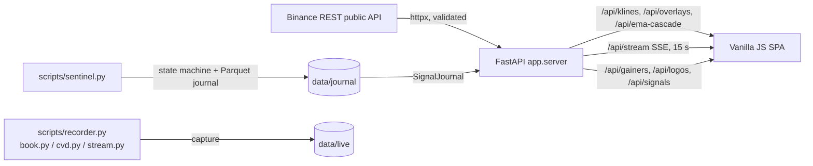

# SIGNAL-X

Observation-only market dashboard: a FastAPI backend over public Binance data,
a no-build vanilla-JS charting SPA, an optional Ollama Cloud trading-partner
drawer, and a set of research/recording scripts.

> **Not financial advice, not a trading system.** The G0 full-universe rerun
> killed the short-edge hypothesis on 2026-10-17 (see
> [`reports/g0_full/VERDICT.md`](reports/g0_full/VERDICT.md)). Everything the
> dashboard shows — EMA cascades, divergences, resistance zones, plateau boxes,
> the sentinel journal — is an *observation*, not a validated trade signal.
> There are no order-entry endpoints.

---

## How it works



- **`app/server.py`** — async FastAPI. Stateless reads over `signalx.feeds`
  (whitelisted Binance endpoints, strict symbol/interval validation), plus an
  SSE loop for live snapshots. The SPA is plain static files: no build step, no
  CDN.
- **`app/static/`** — `chart.js` renders candles/line with EMA overlays,
  pivots, structure/BOS, resistance zones, AVWAP, plateau box, divergence
  labels and a zone-colored RSI pane on canvas. `app.js` wires data polling,
  the observation panel, gainers, notifications and sounds. `chat.js` is the
  optional trading-partner drawer; its Ollama Cloud key stays server-side.
  `logo.js` is the animated header.
- **`signalx/`** — the analysis package: feeds/validation, live snapshot,
  EMA cascade, overlays, flow/order-book proxies, journal, universe screening,
  studies, alerts, the SNIPER V3 1H/15m/5m observation engine, and the
  server-side chat context/prompt layer.
- **`scripts/`** — long-running workers and research runners (see
  [Workers & scripts](#workers--scripts)).
- **`tests/`** — 865 pytest tests covering validation, feeds, overlays,
  studies, flow features, SNIPER V3 causality/backtest logic, the chat
  API/context/prompt layer, the API and the alert redaction layer.

Data is fetched live from public Binance endpoints; nothing is written by the
web app. The journal and capture data belong to the scripts.

---

## Requirements

- Linux (developed on Kali; WSL works) with Python **3.11+** (tested on 3.14)
- A browser with ES2020 + canvas (any current Chrome/Firefox/Safari)
- Network access to `api.binance.com`, `fapi.binance.com` and (optional,
  cosmetic coin icons) `api.coingecko.com`
- Optional: an Ollama Cloud API key for the trading-partner drawer. The dashboard
  and market data work without it.

## Installation

### As a command (native tool install)

```bash
git clone https://github.com/Charpoh-Dehm99/signal-x.git
cd signal-x
pipx install .        # or: python3 -m pip install .
signal-x              # dashboard on http://127.0.0.1:8000
signal-x --port 9000  # any port
```

`signal-x` also takes `--host` and `--reload` (dev). On Termux, install
`pkg install python git python-pyarrow` first (pyarrow has no Android wheel;
the Termux package supplies it), then `pip install .`. If pip tries to compile
`pydantic-core`, add `pkg install rust clang`.

### From a checkout (development)

```bash
git clone https://github.com/Charpoh-Dehm99/signal-x.git
cd signal-x

python3 -m venv .venv
.venv/bin/pip install -U pip
.venv/bin/pip install -r requirements.txt
```

Development extras:

```bash
.venv/bin/pip install pytest anyio
# optional: full research-script deps (pandas/numpy/websockets/requests)
.venv/bin/pip install -e ".[research]"
# linters used during development (isolated):
pipx run bandit -q -r signalx scripts app
```

## Quick start

```bash
signal-x
# or from the checkout:
.venv/bin/python -m uvicorn app.server:app --host 127.0.0.1 --port 8000
```

Open <http://127.0.0.1:8000>. Interactive API docs (OpenAPI) live at
`/api/docs`.

Useful environment variables:

| Variable | Default | Purpose |
|---|---|---|
| `SIGNALX_JOURNAL_DIR` | `data/journal` | where the API reads the sentinel journal |
| `SIGNALX_SNIPER_DIR` | `data/sniper` | persisted SNIPER assignments and latest monitor snapshots |
| `SIGNALX_HEARTBEAT` | `data/sentinel_heartbeat.json` | sentinel sweep heartbeat the dashboard reads for freshness |
| `OLLAMA_API_KEY` | unset | Ollama Cloud key for the optional trading partner; server-side only |
| `SIGNALX_OLLAMA_KEY_FILE` | `~/.config/signal-x/ollama.key` | alternative key file (first non-empty line; use `chmod 600`) |
| `SIGNALX_CHAT_MODEL` | `minimax-m3.1-flash` | default Ollama Cloud model used by the trading partner |
| `SIGNALX_CHAT_MODEL_FILE` | `~/.config/signal-x/chat_model` | persisted dashboard model selection; overrides `SIGNALX_CHAT_MODEL` |
| `SIGNALX_CHAT_THINK` | `low` | thinking effort: `low`, `medium`, `high`, `true` or `false`; M3.1 Flash cannot fully disable thinking |
| `SIGNALX_CHAT_MAX_TOKENS` | `20480` | output cap; thinking tokens count toward it, and too small a cap yields an empty reply |
| `SIGNALX_CHAT_TIMEOUT_S` | `300` | Ollama Cloud request timeout in seconds |

> Bind to `127.0.0.1` only. The app has **no authentication** by design — it is
> a single-user localhost tool. If you expose it beyond your machine, put it
> behind a reverse proxy with TLS and auth.
>
> The dashboard works without credentials. The trading partner is offline until
> an Ollama Cloud key is available; the browser never receives the key.

---

## Dashboard usage

| Area | What it does |
|---|---|
| Search / `WATCH` | Load any Binance spot or USDT-M futures symbol (auto-detected) |
| Futures gainers | Top 24h movers; click to load. Gold accent = top 1% of liquid perps |
| Timeframes | `1m · 5m · 15m · 1h · 4h` |
| Overlay chips | EMA 8·13·21, swing pivots, structure, BOS/CHoCH, resistance zones, AVWAP, plateau box, divergence, RSI pane — persisted in `localStorage` |
| Observation panel | Live state badge, events, vol-z/funding/plateau donuts, layers readout (right rail) |
| SNIPER V3 watchlist | Assign up to 10 coins in the right-rail card; the server monitor evaluates them on closed 5m bars and shows the latest setup/no-setup state. `NOTIFY` enables the bell + optional desktop alert on new LONG/SHORT transitions. Observation only. |
| Fat money | CVD, taker-buy ratio, large prints, book imbalance and absorption proxies (observation only) |
| Signals table | Sentinel journal rows, newest first; header shows sentinel heartbeat age (data freshness, never fetch time) and an explicit offline state |
| Bell | Notification history (persisted, filterable by kind, free-text search, unread tab badge) |
| Sound | WebAudio chimes for EMA crosses/cascades, top-1% entries, journal signals, hot/warn events; volume slider |
| Chart controls | Candle/line mode, full-width chart, reset/live pill |
| Trading partner (`c`) | Optional right-hand drawer; a friendly, pattern-aware read of the loaded symbol/timeframe from Ollama Cloud `minimax-m3.1-flash` and 36 chart lenses. Observation-only; no trade instructions. |
| Paper companion | Optional simulated account panel: open paper shorts, running P&L, recent exits and the HALT-entries button. Requires `scripts/companion.py`; never sends an order. |

Chart gestures follow TradingView: wheel/pinch = zoom at the cursor or pinch
centroid, drag = pan (with kinetic fling on touch), long-press = tracking
crosshair with the OHLC readout pinned to the corner, single tap = exit
tracking. Drag the right price scale to stretch/compress it, drag the bottom
time scale to change bar spacing, and double-click or double-tap either scale
to reset it (on the plot, double-click/tap resets the whole view). The chart
keeps a TradingView-style right margin and lets you scroll into future
whitespace; the `→ realtime` pill returns to the live edge, as does Escape.
The clock badge beside the live pill counts down to the current candle close,
resets on every timeframe boundary, and turns amber in the final 10 seconds.

Keyboard shortcuts:

| Key | Action |
|---|---|
| `n` | Notifications panel |
| `b` | Full-width chart |
| `c` | Trading partner drawer |
| `1`–`5` | Timeframe 1m/5m/15m/1h/4h |
| `/` | Focus symbol search |
| `Esc` | Close chat/panel / blur input / reset chart view |

RSI line colors: red in overbought (≥ 70), green in oversold (≤ 30), yellow
between. Divergence labels: `div ↑ long` (bullish) and `div ↓ short` (bearish)
mark the bias of the observation — not an entry.

### Trading partner (optional)

The trading-partner drawer sends a question to the server, which builds a compact packet
from the same validated feeds and closed-bar engines as the dashboard, selects
up to 22 of 36 chart lenses, and calls Ollama Cloud model `minimax-m3.1-flash`. The
model gets no tools and no client-supplied chart data. It is asked for a
structured **Read / Evidence / Conflict / Scenarios / Invalidation / Caveats**
answer with exact levels. The **Read** section includes a **Pattern** line that
names only structures supported by the packet's pivots and candles, with a
status of forming, confirmed or failed, or says "No clean pattern". The packet
also exposes `vol_ratio` (latest closed-bar volume versus the prior 20-bar
average) and `pump_failed` (a prior pump broke structure and no longer
qualifies), and the prompt separates volume dry-up/damping from a compression
plateau and from a high-volume dump/failed pump. The voice is warm and peer-to-peer, and the model is
explicitly told not to give buy/sell, entry, size or leverage instructions. M3.1 Flash always emits thinking and its thinking
tokens count toward the output cap, so the defaults use `low` effort, a 20,480
token cap and a 300s timeout; a complex chart can take 1–3 minutes.

The model name in the chat header is editable: choose a suggestion or type any
Ollama model id and press Enter. The dashboard posts it to
`POST /api/chat/model`; the server validates it, persists it to
`~/.config/signal-x/chat_model`, and every later chat request uses that model.
Changing models clears the current conversation. The file overrides
`SIGNALX_CHAT_MODEL`, so the selection survives dashboard restarts.

Set the key on the server (never in the browser or in a committed file):

```bash
export OLLAMA_API_KEY='...'
# or a 0600 file:
mkdir -p ~/.config/signal-x
chmod 700 ~/.config/signal-x
$EDITOR ~/.config/signal-x/ollama.key
chmod 600 ~/.config/signal-x/ollama.key
```

Reload the dashboard, open a chart, press `c`, and check the status line. A key
file is read per request, so reloading is enough; if you use the environment
variable, restart the server. If the key is missing the drawer stays offline
and `POST /api/chat` returns `503`.

The key is omitted from status responses, object representations and upstream
error text. `OLLAMA_CLOUD_API_KEY` is accepted as a legacy alias.

### Paper companion (paper only)

The paper companion consumes new `SIGNAL` rows from the sentinel journal and
simulates a short with the latest traded price plus adverse slippage, taker
fees, stop/TP1/TP2 levels and a time stop. It tracks realized/unrealized P&L,
open risk, and a daily-loss halt; the dashboard panel is read-only and the only
web action is the kill switch at `POST /api/paper/halt`. The companion stores
its state in `data/paper/state.json` and refuses to replay history on first
start. This is an accounting experiment, not a validated strategy and not a
live-trading component.

---

## Workers & scripts

All scripts are observation/capture tools and share the same feed layer.

```bash
# State-machine journal: transitions + short-signal observations for top gainers
.venv/bin/python scripts/sentinel.py --top 40 --tf 5m --interval 60
.venv/bin/python scripts/sentinel.py --top 40 --flow --flow-top 10 --once
.venv/bin/python scripts/sentinel.py --symbols AGTUSDT,AUSDT --once

# Optional Telegram push on TRIGGERED (requires both env vars; text is redacted)
TELEGRAM_BOT_TOKEN=... TELEGRAM_CHAT_ID=... \
  .venv/bin/python scripts/sentinel.py --alert

# Paper companion: simulates fills for journal SIGNAL rows (no exchange orders)
.venv/bin/python scripts/companion.py --once
.venv/bin/python scripts/companion.py --interval 15
```

| Script | Purpose |
|---|---|
| `sentinel.py` | Polls the watchlist (one state-machine step per closed bar), writes day-partitioned Parquet journal rows (`data/journal`) plus a per-sweep heartbeat (`data/sentinel_heartbeat.json`), optional Telegram alerts |
| `sniper_v3.py` | Independent 1H/15m/5m SNIPER V3 observation scan (`--symbol`, `--top`, `--loop`); no journal writes and no orders |
| `companion.py` | Paper-only consumer of journal `SIGNAL` rows: latest price +/- slippage, taker fees, stop/TP1/TP2/time exits, daily-loss halt, state in `data/paper`; no exchange client and no order endpoints |
| `watch_symbol.py` | Single-symbol live watcher (pump/plateau/resistance/squeeze), `--once` for a snapshot |
| `recorder.py` | Records kline cycles for the watchlist into `data/live/klines` |
| `book.py` | Records bookTicker + depth features (spread/imbalance) |
| `cvd.py` | Records per-minute taker buy/sell notional (CVD) |
| `stream.py` | Live websocket tape of large prints |
| `watchdog.py` | Supervises the observation daemons (restarts dead workers) |
| `download_data.py` | Bulk historical klines/funding download into `data/raw` + `data/parquet` |
| `fetch_universe.py` | Refreshes `data/universe.json` (liquid universe) |
| `screen_universe.py` | Full-universe screening funnel driver |
| `run_event_study.py`, `run_funnel_study.py`, `run_h1_study.py` | Research runners (read the local corpus, write `reports/`) |
| `cost_probe.py` | Cost/impact probe from recorded book features |

Generated data lives under `data/` (gitignored — the local corpus is tens of
gigabytes) and logs under `logs/` (gitignored). Research verdicts live in
`reports/` (committed).

---

## API

Read-only, JSON, same-origin (no CORS).

| Endpoint | Description |
|---|---|
| `GET /` | Dashboard SPA |
| `GET /api/health` | Liveness + "observation only" note |
| `GET /api/gainers?top=&min_quote_volume=` | USDT-M futures 24h gainers + universe size |
| `GET /api/klines/{symbol}?market=&tf=&limit=` | OHLCV candles (incl. the in-progress bar) |
| `GET /api/overlays/{symbol}?market=&tf=&limit=` | Pivots, structure, BOS, zones, AVWAP, plateau box, divergence, RSI (closed bars only) |
| `GET /api/ema-cascade/{symbol}?market=&limit=` | EMA 8/13/21 state per 5m/15m/1h/4h + cross propagation |
| `GET /api/snapshot/{symbol}?market=&tf=` | One observation snapshot |
| `GET /api/sniper/{symbol}` | SNIPER V3 1H/15m/5m observation; `decision: null` when a causal gate fails, plus first-failed-gate diagnostics |
| `GET /api/sniper/watchlist` | Assigned symbols + latest closed-bar monitor results |
| `POST /api/sniper/watchlist` | Assign `{"symbol": "BTCUSDT"}`; wakes the monitor |
| `DELETE /api/sniper/watchlist/{symbol}` | Remove a symbol from the SNIPER watchlist |
| `GET /api/stream/{symbol}?market=&tf=&interval=&polls=` | SSE push loop (interval ≥ 1 s) |
| `GET /api/signals?limit=&signals_only=` | Sentinel journal rows + latest state per symbol + `now_ms`/`latest_ts_ms` + sentinel heartbeat status |
| `GET /api/paper` | Paper companion state: equity, realized/unrealized P&L, open paper positions, recent exits, halt status, companion heartbeat (read-only) |
| `POST /api/paper/halt` | Creates the paper-entry kill switch file; blocks new paper entries only, never touches an exchange |
| `GET /api/logos?symbols=BTC,ETH,...` | Cosmetic CoinGecko icon map (cached, always 200) |
| `GET /api/chat/status` | Chat readiness, model, skill count; never the key |
| `GET /api/chat/skills` | Public 36-lens catalog (no internal instructions/triggers) |
| `POST /api/chat` | Server-side Ollama Cloud chart analysis; `503` without a key |
| `POST /api/chat/model` | Persist `{model}` for subsequent chat requests; no key required |

Symbols must match `^[A-Z0-9]{4,20}$` and intervals are whitelisted; invalid
input returns `400`, upstream trouble `502`, insufficient data `422`.

`GET /api/sniper/{symbol}` is an observation endpoint, not a trade endpoint. It
evaluates closed 1H/15m/5m candles and returns the setup, risk plan, Mastermind
confidence and filter context. `diagnostics` explains the first failed gate
(for example `htf` / "1H structure is neutral") and marks later checks as
skipped. It never writes a journal `SIGNAL` and never places an order. Assigned
symbols are persisted under `data/sniper/` and the
in-process monitor re-evaluates them after each closed 5m bar; the watchlist
API is observation-only too. The algorithm and validation protocol are
documented in [`docs/SNIPER_V3.md`](docs/SNIPER_V3.md).

Overlay payloads truncate for display only: latest 6 BOS/CHoCH breaks, top 5
resistance zones, latest 4 divergences per direction. `avwap.anchor_mode` is
`display_max_volume` — the heaviest-volume bar over the loaded window, a
display anchor (hindsight) that is never fed back as a signal input.

`POST /api/chat` accepts `{message, symbol, market, tf, history}`; the chart
packet is built server-side, not accepted from the client. `POST /api/chat/model`
accepts `{model}` and writes the normalized model id to the model file; invalid
or unsafe ids return `400`. Chat errors map to
`400` (bad symbol/timeframe), `422` (request validation), `429` (Ollama rate
limit), `502` (context/upstream failure), `503` (missing/rejected key) and
`504` (timeout).

## Security posture

Localhost tool with no accounts and no order endpoints; the only write from the
web app is the paper kill switch (`POST /api/paper/halt`). Still hardened:
strict whitelists for symbols/intervals and upstream paths (no URL string
interpolation), CSP + `nosniff`/frame/referrer/permissions headers on every
response (including SSE), all upstream/journal strings HTML-escaped before
rendering, size caps on upstream payloads and in-process caches, and secret
redaction in the alert layer. The Ollama Cloud key is server-side only; chat
status, `repr` and upstream error text redact it, and the model has no tools.

## Tests

```bash
.venv/bin/python -m pytest -o addopts="" -q   # 865 passed
```

---

## License / disclaimer

Private project, shared for reference. Public exchange data only; no
credentials are required for the dashboard. The optional trading partner requires
an Ollama Cloud key. Markets are risky; this repository contains no validated
edge and nothing here should be used to place orders.
